# Grafik aktual vs prediksi

Semua grafik membandingkan aktual dengan empat varian model untuk prediksi satu hari ke depan (H+1), menggunakan origin harian pada bagian uji. Satuan harga mengikuti data PIHPS untuk komoditas tersebut.

## Ringkasan metrik

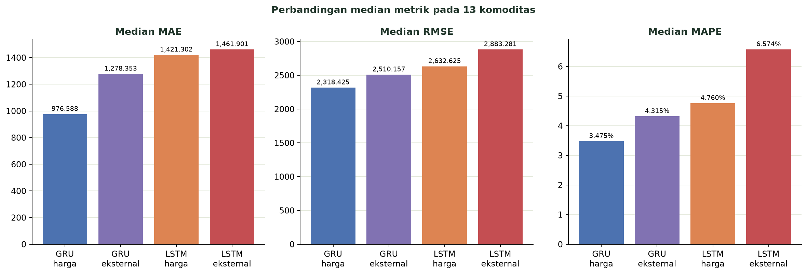

## Bawang Merah

Titik uji H+1: 416.

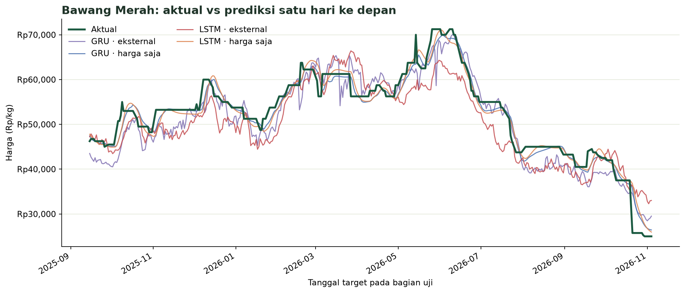

## Bawang Putih

Titik uji H+1: 489.

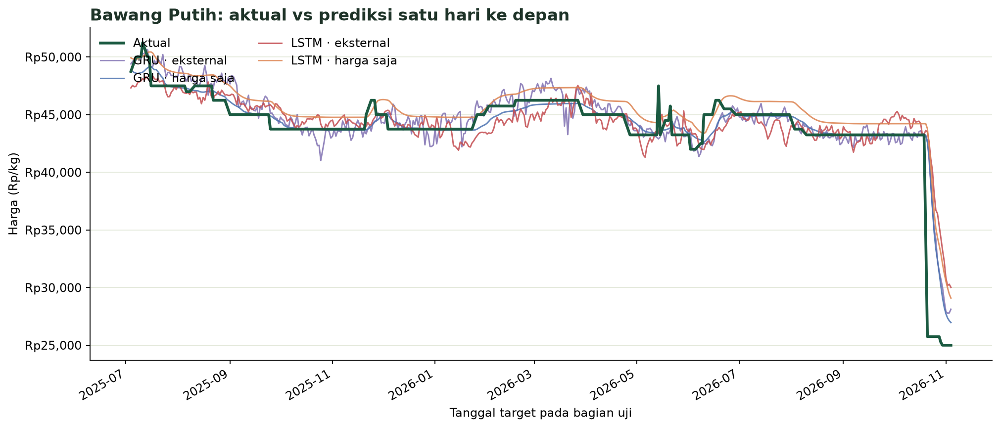

## Beras

Titik uji H+1: 489.

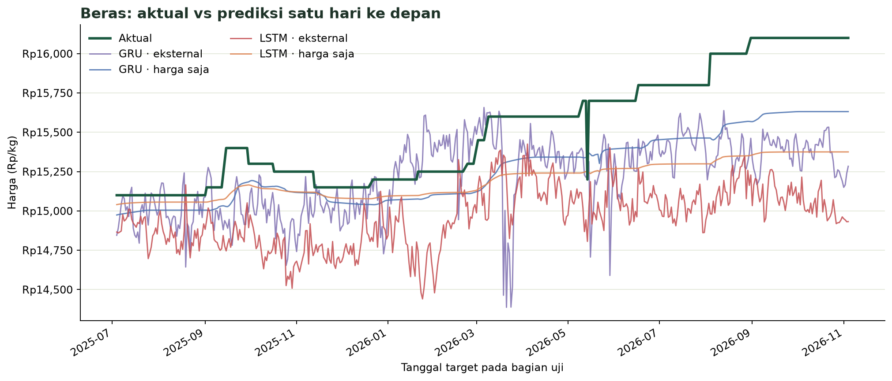

## Cabai Merah

Titik uji H+1: 485.

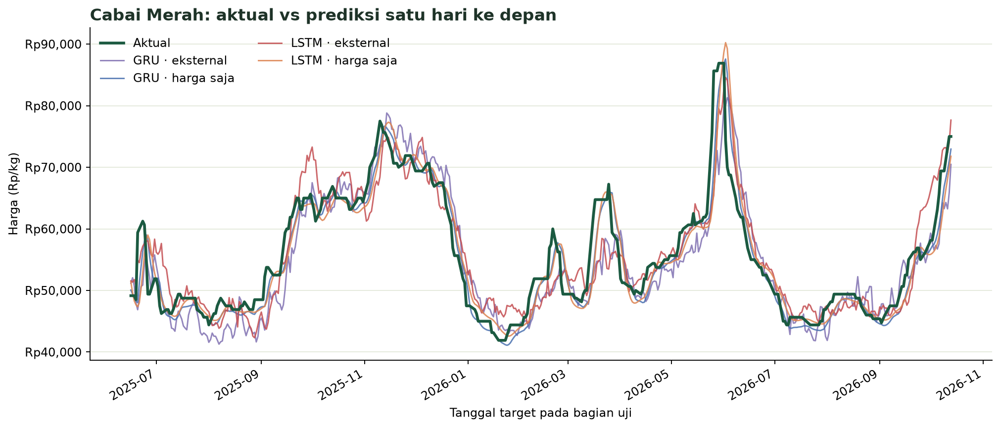

## Cabai Rawit Hijau

Titik uji H+1: 489.

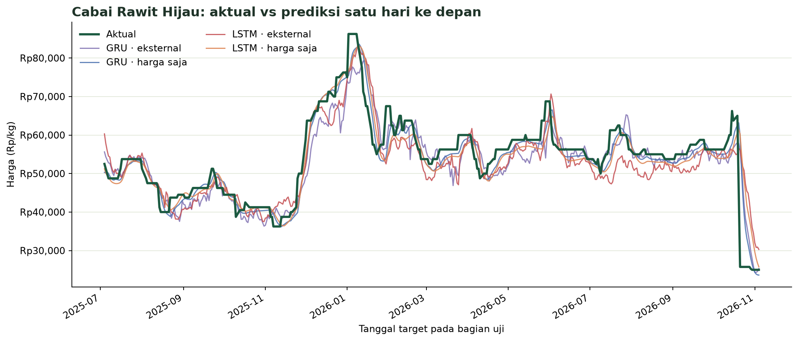

## Cabai Rawit Merah

Titik uji H+1: 489.

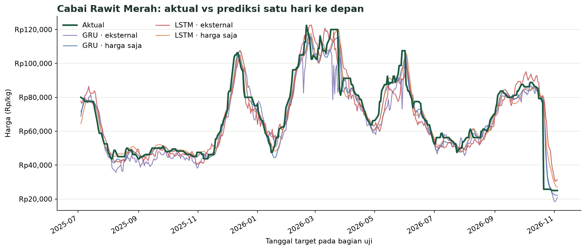

## Daging Ayam

Titik uji H+1: 489.

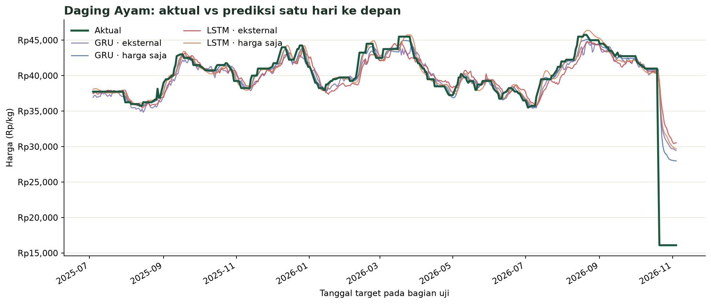

## Daging Sapi

Titik uji H+1: 489.

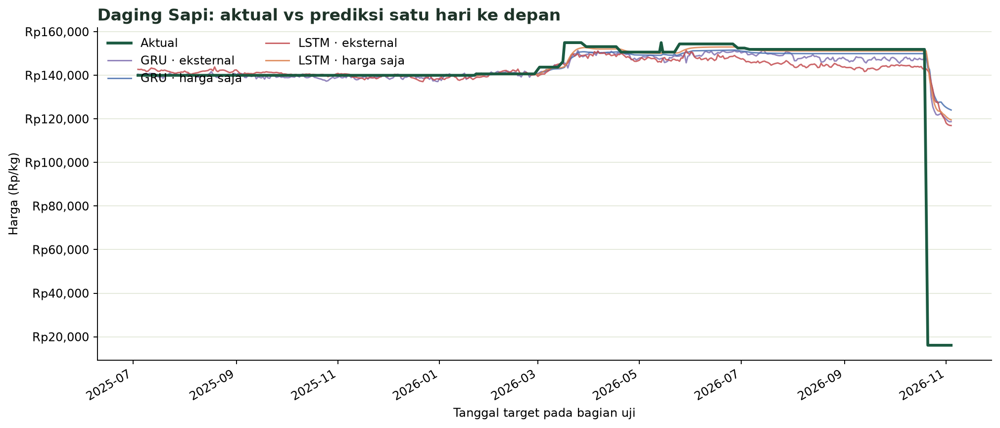

## Gula Pasir Kualitas Premium

Titik uji H+1: 485.

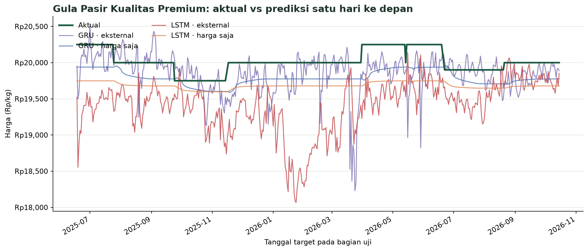

## Gula Pasir Lokal

Titik uji H+1: 339.

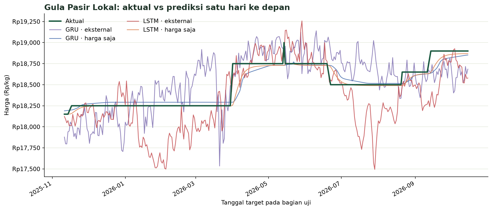

## Minyak Bermerk

Titik uji H+1: 489.

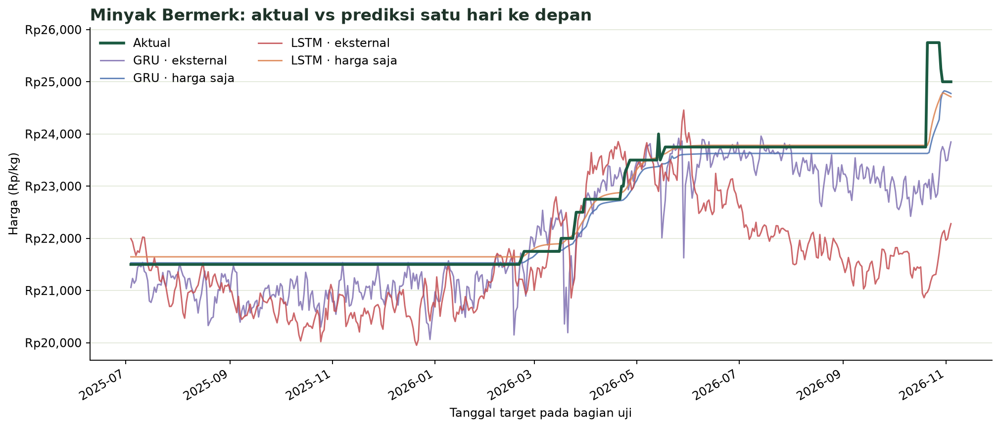

## Minyak Curah

Titik uji H+1: 489.

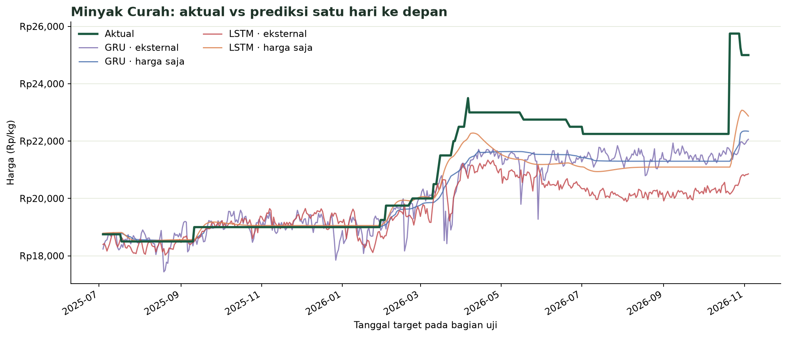

## Telur Ayam

Titik uji H+1: 489.

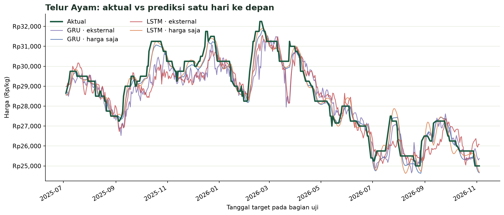
